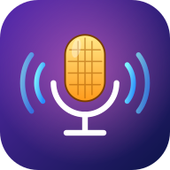

# 🎙️ Voice Craft

**Run your own sound studio. Act out the lines. Impress the clients. Become a Voice Legend.**

---

## 📖 About

You are a sound engineering studio owner. You start out alone in a garage, but word gets around, and soon the best game studios want **YOU**.

Use the money you earn to decorate your studio and hire sound engineers. Better engineers mean better work, which means more money, and the cycle keeps going.

**Your real voice is the game.** There are no buttons to fake it. Each client wants a specific kind of performance (loud, soft, deep, dramatic...) and the game listens to your recording to judge it.

## ⬇️ Download & Play

| Platform | How to get it |
|---|---|
| 🌐 **Web** | [**Play now**](https://mostafa-elaasar.github.io/Voice-Craft/), nothing to install |
| 🤖 **Android** | Download `Voice-Craft.apk` from the [latest release](../../releases/latest) and install it |
| 🐧 **Linux** | Download `VoiceCraft.x86_64` from the [latest release](../../releases/latest), make it executable and run it |
| 🪟 **Windows** | Download `VoiceCraft.exe` from the [latest release](../../releases/latest), ren the executable |
| 🍎 iOS, macOS, 🥽 visionOS | 🔜 Coming soon |

> 🎤 **The game needs your microphone.** Allow the permission when asked. On the web, use a modern browser over HTTPS.

## 🎮 How to Play

1. **Meet the client.** They tell you the line to say and what kind of voice they want.
2. **Do a Voice Check** the first time. This teaches the game what your normal voice sounds like, so any voice works.
3. **Hold the red button** (or hold `Space` on PC/web) and perform the line.
4. **Play back** to listen to yourself.
5. **Submit** before the patience bar runs out!

### 🎯 What the clients ask for

| Request | What to do |
|---|---|
| 🔊 **LOUD** / 🤫 **SOFT** | Project your voice, or drop to a quiet voice |
| 🐭 **HIGH VOICE** / 🐻 **DEEP VOICE** | Go squeaky, or rumble from your chest |
| ⚡ **FAST** / 🐢 **SLOW** | Rush the line, or stretch every word |
| 🎭 **DRAMATIC** / 🤖 **FLAT** | Act it out with big emotion, or talk like a robot |

Early clients ask for one thing. Higher-level clients ask for up to **four at once**. After every try, you get a score for each trait and a hint on what to fix.

> ⭐ Score high enough to pass, and finish faster for more stars, more money and more REP.

## ⭐ REP & Levels

Happy clients **raise** your REP. Angry clients, or ones who get tired of waiting, **lower** it. Gain enough REP and your studio levels up (with a long vibration on phones!).

| Level | REP needed |
|---|---|
| 🏚️ Garage Newbie | 0 |
| 🛏️ Bedroom Producer | 50 |
| 🎧 Indie Studio | 150 |
| 🎬 Pro Studio | 400 |
| 🏭 Hit Factory | 900 |
| 👑 Voice Legend | 2,000 |

## 🛒 Upgrade Your Studio

Spend your cash in the **Shop**:

| Upgrade | Effect |
|---|---|
| 💼 **Sound Engineer Salary** | Earns you money every second. A higher salary unlocks **voice filters** one by one, and at high level your engineer applies them **for you** |
| 🎙️ **Pro Microphone** | Bigger payout on every order |
| ☕ **Coffee Machine** | Clients wait longer |
| 🪩 **Cool Decor** | Earn REP faster |

## ✨ Features

- 🎤 Real voice analysis: pitch, volume, pace, emotion and clarity
- 🗣️ 48 different client requests that scale with your level
- 📱 Portrait and landscape layouts that adapt to any screen
- 📳 Haptic feedback on phones
- 💾 Auto-saving progress
- 🌍 Runs on Web, Android and Linux, with more platforms on the way

## 🤝 Contributing

Found a bug or have an idea? [Open an issue](../../issues). Pull requests are welcome!

---

Made with ❤️ and a lot of shouting into the microphone (in testing) By Mostafa Elaasar.

